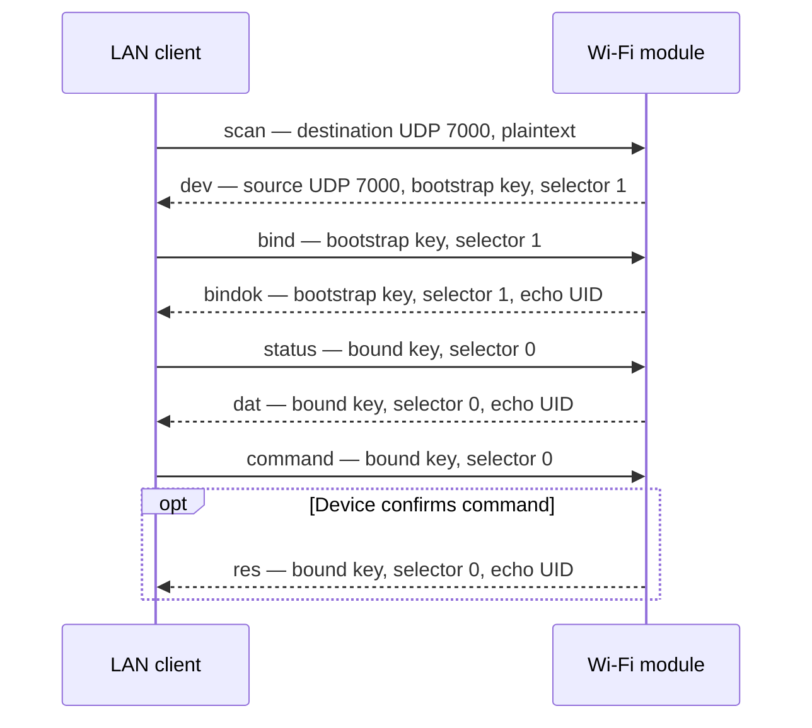
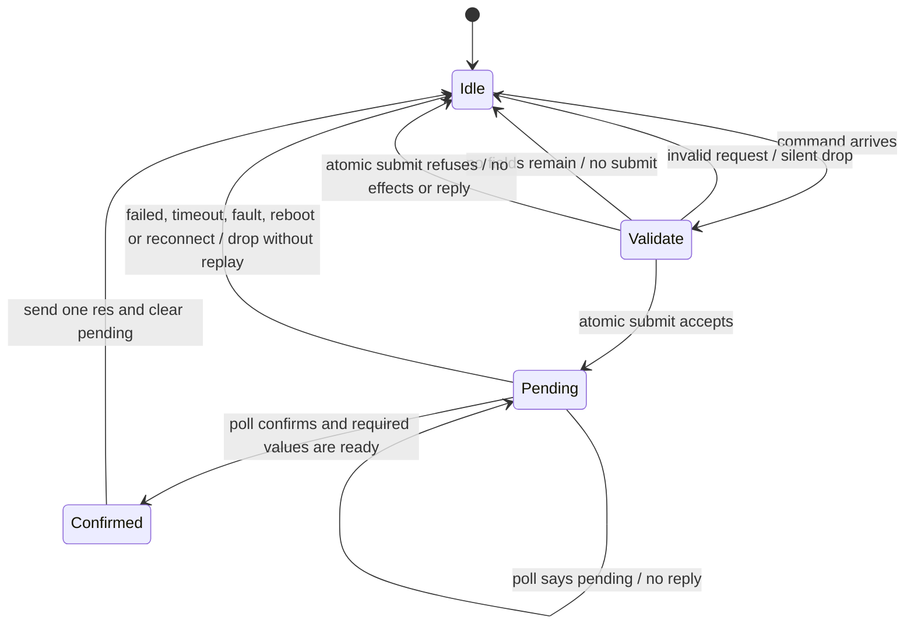

# Gree CipherV2 LAN protocol

## Scope

This is the IPv4 LAN contract between a client and the Wi-Fi module, not UART framing or proof of appliance capability. Device support, writable ranges and completion conditions require the exact-target contract.

## Quick reference

| Setting | Rule |
|---|---|
| Transport | IPv4 UDP, module listens and replies from port `7000` |
| Reply route | Actual request source address and port; never inner JSON |
| Discovery | Unicast or local broadcast |
| Direction | Client → Wi-Fi module; module → client |
| Endpoint change | Never replay pending intent |

| Identity / payload | Required value |
|---|---|
| Module identity | Station MAC: 12 lowercase hex characters, no separators; never clone another unit |
| Name | `gree-` plus the MAC's last six characters |
| Scan routing | Outer `cid=MAC`; inner `cid=MAC`, `mac=MAC`; no `hid` |
| Scan metadata | `mid="10001"`, `ver="V1.2.1"`, `brand="gree"`, `model="gree"`, `bc=""`, `catalog="gree"`, `series="gree"`, `vender="1"`, integer `lock=0` |
| Status metadata | Always supply locally owned `hid="362001000762+U-CS532AE(LT)V3.33.bin"`, `mid="10001"`, and module `name` |

The synthetic vector identity is `020000123456` / `gree-123456`. The HID is a compatibility/calibration label, not a vendor-firmware claim; boot output identifies the replacement firmware.



Only device confirmation permits `res`; the client defines no completion deadline or guarantee.

## Wire format and cryptography

| Constant | Exact value |
|---|---|
| Cipher | AES-128-GCM only |
| **Fixed nonce** | **12 bytes:** `54 40 78 44 49 67 5a 51 6c 5e 63 13` |
| AAD | ASCII `qualcomm-test` (13 bytes) |
| Tag | 16 bytes |
| Bootstrap key | ASCII `{yxAHAY_Lm6pbC/<` (16 bytes) |
| Synthetic vector bound key | ASCII `0123456789abcdef` (test only; never deploy) |
| Block padding | None; ciphertext length equals UTF-8 plaintext length |

**Security risk:** the fixed nonce is reused for GCM messages, violating nonce uniqueness. The public bootstrap key and local bind are not strong authorization. Require tag verification; use a trusted, isolated LAN and never forward UDP 7000 to the internet.

An encrypted message carries one UTF-8 JSON object, encrypted and authenticated, with ciphertext and tag base64-encoded separately. Use standard base64 alphabet and padding. JSON member order and whitespace are not wire requirements; client-style spaced JSON and compact JSON both interoperate. Frozen vector bytes are not a canonical encoding.

```text
UDP JSON envelope
  plaintext routing fields + base64(ciphertext) + base64(tag)
      ↓ AES-128-GCM; verify tag before consuming plaintext
  authenticated inner JSON
```

**Synthetic shape only** (placeholders are not valid base64 or sendable):

```json
{"t":"pack","i":0,"uid":7,"cid":"app","tcid":"020000123456","pack":"<base64 ciphertext>","tag":"<base64 16-byte tag>"}
```

Inner plaintext example: `{"t":"status","mac":"020000123456","cols":["Pow"]}`.
Every listed member is required in an encrypted envelope.

| Outer key | Type | Value / rule |
|---|---|---|
| `t` | string | Encrypted envelope: `"pack"` |
| `i` | integer | Integral JSON number, not bool/string: `1` for bootstrap scan/bind; `0` for bound status/command; must match key and operation |
| `uid` | integer | Lossless integral JSON number in `[-9007199254740991,9007199254740991]`; no bool/string coercion; bind request may use any allowed outer UID; replies echo it; scan reply uses `0` |
| `cid` | string | Request normally `"app"`; replies use module MAC |
| `tcid` | string | Request targets exact module MAC; reply uses validated request `cid`; scan reply uses `""` |
| `pack` | string | Standard-base64 ciphertext |
| `tag` | string | Standard-base64 GCM tag; exactly 16 decoded bytes |

Requests target the exact replacement MAC in outer `tcid` and inner `mac`. Replies use outer `cid=MAC`, `tcid=request.cid`. For encrypted traffic, the fixed AAD and encrypted payload are authenticated; outer routing and selector fields are not AAD and must be validated separately.

| Operation | Request | Response |
|---|---|---|
| Scan | Plaintext `{"t":"scan"}` | Bootstrap key, selector 1, UID 0; inner `t="dev"` and scan metadata |
| Bind | Bootstrap key, selector 1; outer UID may be any allowed value; inner `{"t":"bind","mac":MAC,"uid":0}` | Bootstrap key, selector 1; `bindok` with same MAC, echoed outer UID, stable key and `r=200` |
| Status | Bound key, selector 0; `{"t":"status","mac":MAC,"cols":[...]}` | Bound key, selector 0; `dat`, echo UID and route |
| Command | Bound key, selector 0; `{"t":"cmd","mac":MAC,"opt":[...],"p":[...]}` | `res` only after actual completion; echo UID and route |

Bootstrap key is for scan/bind; bound key is for status/command, with the matching selector. Reject all key/selector/operation mismatches. No ECB, V1, key trial/fallback, or plaintext bind/status/command. In production use bundled Mbed TLS GCM (`mbedtls_gcm_crypt_and_tag`, `mbedtls_gcm_auth_decrypt`), not custom AES/GHASH. Authenticate the complete ciphertext and tag before parsing plaintext, calling `DevicePort`, changing pending state, UART or NVS. Never consume plaintext from unauthenticated decryption; the client decrypts without verifying tags.

## Binding and confidentiality

After Wi-Fi/RNG initialization, generate 12 random bytes with `esp_fill_random`; standard-base64 encoding yields a stable 16-byte ASCII key. Persist once at NVS namespace `gree`, key `bind_key`; reuse across binds and reboots. Repeated bind does not rotate the key, change session ownership or operate HVAC.

Key generation/storage belongs to runtime, not `Lan`; its constructor receives the established key. If required storage cannot initialize, read or write, disable bind/control rather than report success. Do not erase the whole NVS partition automatically; recovery is explicit. Parse/authentication failures cause no NVS activity. Never log keys, credentials or plaintext commands.

## Validation limits

Replacement input-policy limits, not historical device limits. Exact-target rules own field support/types, writable ranges, normalization, command duplicate/order semantics and confirmation. Outer UID limits are in the key table above.

| Input bound | Limit |
|---|---|
| UDP envelope | ≤4096 bytes total, including whitespace and both base64 strings; exact valid boundary accepted |
| Parser arena | Reusable 32 KiB |
| JSON depth | ≤16 containers per separately parsed document |
| Array entries | ≤64 in `cols`, `opt` or `p` |
| Property name | String, ≤63 UTF-8 bytes |
| Application text | ≤127 UTF-8 bytes per value |
| Command integer | Finite, mathematically integral signed `int32`: `[-2147483648,2147483647]`; reject coercion, rounding, truncation and booleans |

| Check | Required behavior |
|---|---|
| Envelope | Reject truncation/oversize; never accept a prefix. Parse by length; never overrun a terminator. |
| Packed size | Bound encoded `pack` by actual envelope capacity. Precheck decoded size before base64 decoding/writes; check ciphertext/plaintext capacity before GCM. |
| Text scope | Text limit excludes `pack`, `tag` and full plaintext; default status `pack` exceeds it. Text capacity does not authorize metadata writes. |
| Base64 / tag | Strict standard alphabet and padding; no malformed padding, nonalphabet bytes or partial decode. Tag length is in the crypto table. Missing/wrong-type/short/long tags, bad ciphertext base64 and failed authentication silently drop. |
| Arena / depth | Fail closed on arena exhaustion. Enforce depth in host and ESP builds for both separately parsed documents, not one combined DOM. Root=1, each object/array +1, scalars +0; count ignored members. |
| Depth examples | Depth-16 nested `cols` fails the application type rule; depth 17 fails parsing. |
| JSON structure | Require complete strict JSON and UTF-8; reject duplicate object names at any depth, trailing non-whitespace, NaN and Infinity. |
| Strings / NUL | Reject any raw NUL that could terminate an accepted prefix, and decoded NUL hidden by C-string APIs. Check escapes after decoding; lengths count UTF-8 bytes. |
| Command values | Nested arrays/objects, booleans and null are not values. `cols` is names; `opt`/`p` are equal, nonempty arrays. See Client augmentation and buzzer compatibility for filtering/atomicity; Status semantics covers duplicate columns. |
| Invalid packets | No negative reply or packet-induced UART/control/cache/NVS effect; do not change/cancel pending work. Independent polling/bootstrap may continue unchanged. |
| Arena check | Exercise exhaustion by host harness or allocator fault injection; crypto checker does not measure cJSON allocation or prove depth configuration. |

## Status semantics

Inner JSON examples use the fixture MAC `020000123456`; it is synthetic identity, not a key.

`status.cols` requests names. `dat.cols` and `dat.dat` are position-aligned:

| Field / `DevicePort::read` | `dat` response |
|---|---|
| Module-owned `hid`, `mid`, `name` | Return the local value in the requested position |
| `known` | Return the name and integer or text value, including `0` |
| `unavailable` (supported but unobserved/stale) | Return the name and `null` |
| `unsupported` | Omit the name and corresponding value |

Keep duplicates and request order; an empty request returns empty arrays. Unknown names never alias another slot. Unsupported names within common limits are valid and omitted. The client merges received values, so omission does not clear its cache; return `null` for stale but supported fields.

Status request (synthetic fixture):

```json
{
  "t": "status",
  "mac": "020000123456",
  "cols": ["TemSen", "Pow", "TemSen", "unknown", "Lig"]
}
```

Conditional `dat` example for an observed temperature of `25°C`, not a physical test result:

```json
{
  "t": "dat",
  "mac": "020000123456",
  "r": 200,
  "cols": ["TemSen", "Pow", "TemSen", "Lig"],
  "dat": [25, 0, 25, null]
}
```

This firmware must always publish the actual temperature: `TemSen=25` for `25°C`, never the original protocol's `+40`-offset value.

> **Original protocol:** With Celsius state and the compatibility HID, the client maps encoded `TemSen=65` to `25°C` by subtracting 40. This legacy correction must not be applied to this firmware's actual temperature values.

## Commands, pending state and completion

Inner messages (outer encrypted envelope omitted):

| `t` | Fields | Meaning |
|---|---|---|
| `cmd` | `opt` names and aligned request values in `p` | Equal, nonempty arrays; entry and value limits are in the common validation table |
| `res` | `opt` names and aligned confirmed values in `val` | Preserve admitted order; return normalized/confirmed values, not request `p` |

Command request from the synthetic vector; exact-device validation is still required:

```json
{
  "t": "cmd",
  "mac": "020000123456",
  "opt": ["Lig"],
  "p": [1]
}
```

Conditional post-confirmation response example; this does not establish physical control success:

```json
{
  "t": "res",
  "mac": "020000123456",
  "r": 200,
  "opt": ["Lig"],
  "val": [1]
}
```

Validate the whole request, including every buzzer value, before applying the compatibility rule below. Preserve the remaining order. If filtering removes every field, do not submit, create pending state or reply. `DevicePort::submit(settings, now_ms)` is the exact-target atomic gate for writability, values, normalization, readiness and busy state; refusal is silent and has no partial effects.

Keep at most one fixed-capacity pending record: sender endpoint, request UID/CID and validated field names/values. Pending values never become status state.



`receive` may reply immediately to discovery, bind or status, but not to a transmitted or pending command. `poll(now_ms, reply)` sends one `res` only after `DevicePort::command_state` is confirmed; invalid packets cannot alter pending bookkeeping.

| Control type | Evidence required before `res` |
|---|---|
| Persistent | Fresh observed controller readback; unavailable required values mean no reply |
| Command-only | Exact-target acknowledgement condition and accepted normalized value; no fabricated persistent readback |

A vendor/client echo, send completion or optimistic client cache is not command confirmation. Firmware/hardware evidence gates the LAN response, not the client timeout; actual acknowledgement predicates and deadlines remain unknown until specified for the exact target.

### Client augmentation and buzzer compatibility

`push_state_update()` appends these fields after user-changed properties:

| Client state | Added fields, in order |
|---|---|
| `device.buzzer=True` | `BuzzerCtrl=1` |
| `device.buzzer=False` | `Buzzer_ON_OFF=1`, then `BuzzerCtrl=0` |
| Dirty `SetTem` | Cached `TemRec`, then `TemUn`, before buzzer fields |

Changing `device.buzzer` alone does not dirty a field or send. Change a real supported control to trigger a high-level command. `SetTem` needs previously observed `TemRec` and `TemUn`; missing cache entries become `null` and must not be coerced.

This compatibility exception covers only the two buzzer names the existing client may append:

| Field and availability | Handling |
|---|---|
| `BuzzerCtrl` or `Buzzer_ON_OFF` is `unsupported` | Omit after validation and from any result |
| Either is `known` or `unavailable` | Do not strip; use normal target validation and confirmation |
| Any other field is `unsupported` | Refuse the whole command |

Omission is not buzzer support or a successful no-op. Malformed values remain invalid.

## Client quick reference

Use a loopback synthetic peer, never a private appliance. Imports: `Discovery` (`greeclimate.discovery`), `create_device` (`greeclimate.device_factory`), `CipherV2` (`greeclimate.cipher`), `Response` (`greeclimate.network`), and `IPv4Address`.

| Operation | Call and event contract |
|---|---|
| Discover | `await Discovery(allow_loopback=True).scan(wait_for=1, target_addresses=[IPv4Address("127.0.0.1")])`; require the synthetic identity, source port 7000 and MID 10001. Client discovery tries V1, then V2 on decrypt failure; this does not add V1 server support. |
| Explicit V2 bind | `device = create_device(info, bind_timeout=<finite timeout>)`; register `Response.DATA`, then `await device.bind(cipher=CipherV2())`. Bind sets the session key and schedules `update_state()` before `BIND_OK` handlers. `ready` means bound only—not valid UART readings or a completed status roundtrip. |
| Default bind fallback | On a fresh device, call `await device.bind()` without setting `ready` or a cached key: the client’s V1 bind attempt times out, then it tries V2. Require no V1 response or packet-induced device effect. |
| Status | Build `device.create_status_message(info, "hid", "TemSen", ...)`, register DATA, then `await device.send(message)`. `await device.update_state()` sends the default poll but does not await its reply. |
| Command | Only use an exact-image-approved control. `device.light` maps to `Lig`; build `device.create_command_message(info, Lig=...)` or use the approved property. Register `Response.RESULT` before `await device.send(...)` or `await device.push_state_update()`. Send/drain is not completion. `push_state_update()` clears dirty fields on send, not confirmation. |
| Events | DATA/RESULT callbacks take one dictionary; BIND_OK takes the key. Cache updates precede callbacks. Use an `asyncio.Event`/Future and predicate, inspect public `hid`, `raw_properties` and `current_temperature` only after the expected DATA, remove the same callback in `finally`, and close an active transport once. Handlers are shared: exercise one device at a time. |

Disable logging for `greeclimate` and every enabled child before binding: logs may expose keys or decoded payloads. Never publish either, including BIND_OK keys or raw bind responses. The client's decrypt success does not verify a GCM tag; independently authenticate each outgoing `pack`/`tag` with PyCryptodome and the matching synthetic/new-device key. Do not use this client smoke as UART or appliance evidence.


### Default MID10001 poll and observed sample

Exact default poll order (19 names):

```json
[
  "Pow", "HeatCoolType", "Mod", "TemUn", "SetTem", "TemRec", "StHt",
  "SvSt", "host", "name", "AllErr", "ModelType", "Dmod", "Add0.5",
  "WdSpd", "Quiet", "Tur", "TemSen", "hid"
]
```

Observed sample fields (20 numeric names plus `hid`, 21 total):

```json
[
  "Pow", "Mod", "SetTem", "TemUn", "TemRec", "TemSen", "WdSpd",
  "Air", "Blo", "Health", "SwhSlp", "SlpMod", "Lig", "SwingLfRig",
  "SwUpDn", "Quiet", "Tur", "StHt", "SvSt", "HeatCoolType", "hid"
]
```

The default poll and observed sample are distinct. Neither is a startup default or writable-control evidence.

## Packet vectors and checker

`test/vectors/lan-v2.json` contains frozen synthetic exact-wire examples, plaintext, authentication outcomes and application dispositions. `tools/research/verify_lan.py` independently checks them with PyCryptodome; it imports no firmware, emulator or client. Do not regenerate fixtures.


From the project root:

```sh
../greeclimate/venv/bin/python -B tools/research/verify_lan.py
```

| Label | Meaning |
|---|---|
| `request` | Structurally valid request, not proof a command is accepted. Unsupported status names may be omitted. |
| `device-validation-required` | Framing/authentication valid; exact-target submit validation remains. |
| `conditional-response` | Depends on synthetic `DevicePort` state or confirmation, not proof of UART success. |
| `reject` | Required silent drop. |
| `authentic=true` | GCM tag verifies; the packet can still be rejected. Authentication is necessary, not sufficient. |
| `authentic=null` | No well-formed GCM pair is asserted, including malformed, plaintext/V1 or missing-tag input. |

Vectors cover plaintext scan; encrypted discovery/bind/default poll, metadata, empty/alignment status and pending responses; raw/default/silent buzzer commands; corrupted ciphertext/tags, missing/short/long tags, wrong keys, bootstrap misuse, selectors and V1 negatives; malformed base64/JSON/types/members/duplicates/depth/addressing; fractional/overflow/null/boolean, mismatched/empty/unsupported commands; 64/65 fields, 63/64 UTF-8-byte names, 127/128-byte text, 4096/4097-byte envelopes and oversized encoded `pack`. All vectors use synthetic data, never private captures.


The checker does not prove production rejection, bounded arena use, no UART effects, runtime event order or appliance behavior. Those require host and hardware checks.

## Verification scope

The bounded `DevicePort` spy tests LAN behavior only. Use synthetic metadata and explicit known/unavailable/unsupported values and submit outcomes. Record reads, submits, order and effects; do not model HVAC state, temperature or UART bytes.

| Layer | Exercises | Does not prove |
|---|---|---|
| Pure-LAN + `DevicePort` spy | LAN validation, routing and state transitions | Production UDP/PTY, UART, NVS or appliance control |
| Production host UDP + PTY | Production cores, loopback UDP and independent exact-image UART vectors | ESP32 boot, NVS persistence or physical HVAC operation |
| Hardware / NVS | Device-specific UART, persistent key and appliance behavior | Not proved by either host layer |

Required pure-LAN coverage:

1. Valid scan/bind/metadata: independently authenticate replies; check destinations, UID/CID echo and selectors. Rebind returns the constructor key without submit.
2. Malformed, unauthenticated, misaddressed and limit-plus-one packets: compare baseline/injected instances at equal timestamps; no reply, submit, visible state or pending change, then valid status succeeds. Allow identical scheduled polling outside LAN.
3. Status order, duplicates, null, omission, zero, empty arrays, known/unavailable integer and text values; unavailable reads never become zero.
4. Pending command: no immediate/poll result, status unchanged, concurrent command refused. Confirmation plus known readback gives one routed result; failure gives none and clears intent. Invalid packets preserve pending state.
5. Arena exhaustion/recovery; depth 16 in both documents and depth-17 rejection; 4096-byte envelope, decoded-size, int32 boundaries, escaped UTF-8 byte lengths, NUL and trailing-junk boundaries. Reject oversized `pack` before buffer writes.
6. Restart without pending replay. Key persistence is a separate NVS/hardware check; a synthetic constructor key does not prove it.

The production UDP/PTY harness—not the spy—checks startup/poll/controller vectors, partial/concatenated/corrupt UART frames, UART loss/failure and the confirmation gate. Without UART evidence, do not claim end-to-end HVAC success.

## LAN-only host verification

From the project root:

```sh
"$HOME/.platformio/packages/tool-cmake/bin/cmake" -S test/host -B .build/host \
  -DIDF_PATH="$HOME/.platformio/packages/framework-espidf" -DCMAKE_BUILD_TYPE=Debug
"$HOME/.platformio/packages/tool-cmake/bin/cmake" --build .build/host
"$HOME/.platformio/packages/tool-cmake/bin/ctest" --test-dir .build/host --output-on-failure
```

