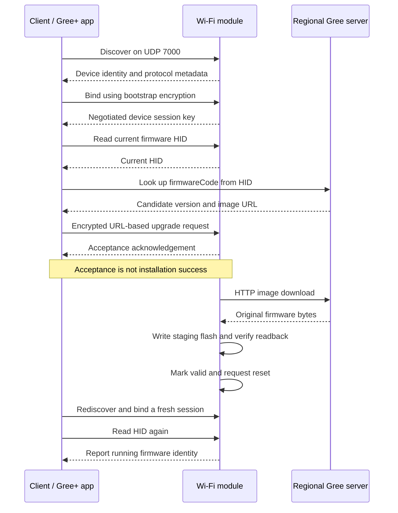

# Gree Wi-Fi firmware update protocol

This reference documents discovery, binding, update requests, image download and post-update verification. It is not permission to flash a device or a guarantee that another module accepts the same image or protocol.

## Evidence and scope

| Evidence | What it establishes | Limit |
|---|---|---|
| [Captured Gree+ exchange](https://github.com/cmroche/greeclimate/issues/111) and [owner's account](https://kaspars.net/blog/gree-amber-nordic-gwh09yd-s6dba1#wi-fi-firmware-update) | App reads HID, looks up regional metadata, sends an encrypted URL-based upgrade request and receives `ret/r=200` | Capture concerns code `362001065736`, QCOM4004C V3.76 requesting V3.77; that attempt did not establish successful installation |
| Exact `362001000762+U-CS532AE(LT)V3.33.bin` application analysis | LAN/cloud upgrade handlers, URL parser, download/write/readback checks, validity marker and reset-request path | Static application evidence; no installed-flash readback, live update or boot-ROM execution |
| [greeclimate v4.2.5 transport](https://github.com/cmroche/greeclimate/blob/v4.2.5/greeclimate/network.py), [packet builders](https://github.com/cmroche/greeclimate/blob/v4.2.5/greeclimate/_protocol.py) and [ciphers](https://github.com/cmroche/greeclimate/blob/v4.2.5/greeclimate/cipher.py) | Client envelope construction, session handling and V1/V2 codec behavior | Client implementation is not evidence that every firmware supports the upgrade command |

The downgrader assumes the high-level URL-based workflow is shared. The URL constraints, image wrapper, flash limits and commit behavior below are qualified to **CS532AE(LT) V3.33** unless stated otherwise. They must not be imposed on another family's original image format.

Examples use synthetic MAC `020000123456`, client ID `app` and placeholder keys/ciphertext. No actual device keys or private captures are included. Examples illustrate message structure, not ready-to-send installation commands.

## 1. Normal sequence



The app performs update-availability lookup; the module retrieves the image itself. A successful download on the client's computer does not prove the module can reach the image server.

Both LAN and cloud handlers in the exact V3.33 application can queue an upgrade URL. Cloud login, relay routing and authentication are not specified here; a disabled LAN listener cannot be reached by inventing a LAN packet. No autonomous application-side `Lastversion` polling was established. An `AutoUpdate` property exists, but its traced direct uses persist/load a preference, not a demonstrated periodic updater.

## 2. UDP envelope and encryption

### Client to device

A bound upgrade request uses this outer JSON object:

```json
{
  "t": "pack",
  "i": 0,
  "uid": 0,
  "cid": "app",
  "tcid": "020000123456",
  "pack": "<base64-ciphertext>"
}
```

### Device to client

The V3.33 upgrade acknowledgement uses:

```json
{
  "t": "pack",
  "i": 1,
  "uid": 0,
  "cid": "020000123456",
  "tcid": "app",
  "pack": "<base64-ciphertext>"
}
```

| Field | Meaning |
|---|---|
| `t` | `pack` identifies an encrypted application payload |
| `cid` | Sender ID: client ID in requests, device MAC in replies |
| `tcid` | Intended recipient: device MAC in requests, client ID in replies |
| `uid` | Account/routing value; these LAN examples use `0` |
| `i` | Selects a key path in the examined V1 implementation; it is not a transaction number |
| `pack` | Base64-encoded encrypted inner JSON, not nested plaintext JSON on the wire |
| `tag` | Additional Base64 authentication tag for V2 packets; absent for V1 |

### Key selection

| Exchange | Examined V1 behavior |
|---|---|
| Bind request/reply | Bootstrap/default key; outer `i=1` |
| Bound status and upgrade request | Negotiated device key; outer `i=0` |
| V3.33 upgrade acknowledgement | Bootstrap/default key; outer `i=1`, despite the request using the device key |

The V1 client codec uses AES-128-ECB with PKCS#7 padding followed by Base64. The V2 client codec uses AES-GCM and includes a 16-byte authentication tag encoded as `tag`; its protocol nonce/AAD are defined in the linked cipher implementation. Original V3.33 update behavior was not established for V2. Negotiate the supported cipher rather than assuming the same key or codec across devices.

An unreadable acknowledgement may be a key-path mismatch, not proof that the request failed. Do not replace the current session key, resend the upgrade automatically, or treat encryption as firmware authenticity verification.

## 3. Application messages inside `pack`

Except for the initial scan request, the JSON below is the **decoded inner payload**, before encryption or after decryption.

| Exchange | Client payload | Device payload |
|---|---|---|
| Discover | Plaintext `{"t":"scan"}` to UDP 7000 | Decoded discovery fields include `{"t":"dev","mac":"020000123456","mid":"10001","ver":"V1.2.1"}`; additional discovery metadata is omitted here |
| Bind | `{"t":"bind","mac":"020000123456","uid":0}` | `{"t":"bindok","mac":"020000123456","key":"<negotiated-key>","r":200}` |
| Read firmware identity | `{"t":"status","mac":"020000123456","cols":["hid"]}` | `{"t":"dat","mac":"020000123456","r":200,"cols":["hid"],"dat":["362001000762+U-CS532AE(LT)V3.33.bin"]}` |
| Request installation | `{"t":"upgrade","mac":"020000123456","url":"http://<image-host>/<image-path>"}` | `{"t":"ret","r":200,"mac":"020000123456"}` |

Discovery `ver` describes protocol/discovery metadata, not the installed build. Read `hid` through a status reply to identify firmware. The prefix before `+` is the candidate firmware code; the remaining name identifies module/variant and version. Do not infer firmware compatibility from a shared MID.

For the normal module update, use the module's MAC. The examined application has separate target selectors for companion images; special target values `"1"` and `"2"` are not substitutes for the Wi-Fi module MAC.

The upgrade handler queues a URL and schedules `ret/r=200` before the download/install result is known. It does not return an installed-image digest or a final successful-installation message. A send/drain completing also does not imply an acknowledgement arrived.

## 4. Regional firmware metadata API

The app queries a regional HTTP(S) endpoint using the firmware code:

```http
GET /wifiModule/Lastversion?firmwareCode=362001000762 HTTP/1.1
Host: na.grih.gree.com
```

The following is an observed V3.33 metadata example, not a promise of current availability:

```json
{
  "CreateDate": "2023-07-14 02:36:29",
  "commProtVer": "V1.2.1",
  "desc": "In this version, we have fixed some known issues.",
  "forcedUpgrade": 0,
  "r": 200,
  "url": "http://na.grih.gree.com/wifiModule/image/10052/182144",
  "ver": "3.33"
}
```

| Field/result | Interpretation |
|---|---|
| `r=200`, `ver`, `url` | An advertised candidate; not a completed download or a LAN-support claim |
| `commProtVer` | Separate communication-protocol version, not firmware `ver` |
| `forcedUpgrade`, optional `frcUpgdType` | Server policy metadata; exact app enforcement was not established |
| Application `r=405` / `Firmware not found.` | No build advertised by this host at this time; not proof that no historical release exists |
| HTTP/DNS/TLS failures | Lookup failed; availability remains unknown |

Regional metadata and returned image hosts can differ. No arbitrary-version query parameter or complete version-list API was verified. Use evidenced historical image URLs for older builds; do not invent IDs or `version=` parameters. See [firmware acquisition](firmware-download.md) for hosts, request safety and provenance, and [firmware versions](firmware-versions.md) for verified LAN targets. A numerically newer release can restore LAN support; cloud-only labels are not universal cutoffs.

## 5. Device HTTP downloader: V3.33 limits

The module parses the supplied URL, resolves its host to IPv4, and opens TCP port 80. Its request template sends the path and **resolved IP** as the `Host` value:

```http
GET /wifiModule/image/10052/182144 HTTP/1.1
Host: <resolved-IPv4>
Accept: */*
User-Agent: Mozilla/4.0 (compatible; MSIE 5.5; Windows 98)
Connection: Keep-Alive
```

| Constraint | Examined behavior / implication |
|---|---|
| URL storage | Decoded C-string length must be below 160 bytes: maximum 159. Longer supplied strings are not copied, rather than safely truncated |
| Scheme/path | Looks for `http://` and a following `/`; this is not a complete standards-compliant URI parser |
| Destination | IPv4 socket, fixed port 80; DNS names are resolved first. No IPv6, HTTPS or custom-port parser in this path |
| Credentials/authentication | No URL-credential or HTTP authentication handling |
| Host validation | No Gree-domain allowlist is visible in this application path; that does not make an arbitrary URL or its image safe |
| Virtual hosting | `Host:` contains the resolved IPv4 address, so a hostname-only virtual host may return the wrong content |
| Response status | Accepts 200 or 206; redirects are not followed. Accepting 206 does not establish resumable-download or `Content-Range` validation |
| Headers | Parses a positive `Content-Length` and `\r\n\r\n` from the first receive buffer, at most 1 KiB; no robust split-header accumulation was established |
| Body encoding | No chunked-transfer decoding or content decompression in this path; serve the uncompressed original bytes |
| Filename | No `.bin` extension or specific filename check visible in this downloader |

A simple ASCII `http://host/path` without credentials, explicit port, fragment, whitespace or control characters is the conservative interoperability form. Prefer a direct 200 response, conventional `Content-Length` spelling and small headers. TCP fragmentation can still expose the parser's assumptions; malformed inputs are not guaranteed to fail cleanly. A host-side GET or `ret/r=200` does not prove this device download completed.

These are restrictions of the inspected firmware, not permission to bypass acquisition URL/TLS checks. A temporary LAN server is a separately approved hosting option for an unchanged, hash-verified Gree original; it must not expose keys or unrelated files.

## 6. Wi-Fi image wrapper and validation: V3.33

The selector-1 Wi-Fi update consumes an original file with this outer wrapper:

| File offset | Size | Encoding | Meaning |
|---|---|---|---|
| `0x00` | 4 bytes | Big-endian unsigned integer | Magic `0x00001234` |
| `0x04` | 4 bytes | Big-endian unsigned integer | Declared payload length, excluding the 24-byte wrapper |
| `0x08` | 16 bytes | Raw digest bytes | Expected MD5 of the payload, not ASCII hex and not MD5 of the whole file |
| `0x18` | Declared payload length | Original firmware payload | Bytes staged and later read back for verification |

### Validation and commit order

1. Parse HTTP status and a positive HTTP content length.
2. Validate the wrapper magic; read its length and expected digest. For selector 1, this embedded length replaces the HTTP length as the expected payload length.
3. Strip the 24-byte wrapper, erase the selected staging region and write received payload chunks. The initialized flash-write gate in this downloaded build is enabled; installed runtime state was not observed.
4. The streaming write path rejects cumulative payload sizes reaching `0x3dff8` (253,944 bytes). This is a write-path bound, not a portable firmware-family size limit.
5. Once the received count reaches or exceeds the declared length, read the declared payload bytes back from flash and compare the resulting 16-byte digest with the wrapper digest. This is **not** strict equality between the complete HTTP body length and the wrapper length; extra received bytes are not evidence of a valid container.
6. After a digest match, write the eight-byte validity marker `4e56524d01000000` (`NVRM`, followed by little-endian version 1). The application may adjust slot-table metadata and enters its reset-request handshake.

The application writes flash **before** digest verification. A mismatch can cause refetches and eventual failure, not a proven automatic rollback. Slot selection/table changes are visible, but a safe atomic A/B swap, boot-success acknowledgement and rollback were not established. The low-level reset-request routine writes `0x100` to address `0x4000`; hardware reset-register semantics and the subsequent boot were not executed.

### Recovered image example

The exact inspected V3.33 source was obtained from the metadata/image endpoints above and matched a previously recorded SHA-256. Source acquisition used explicit HTTP after verified HTTPS failed certificate hostname validation; digest equality does not repair unauthenticated transport.

| Measurement | Value |
|---|---|
| Full file size | 182,144 bytes |
| Wrapper-declared / actual payload size | 182,120 bytes |
| Embedded and independently computed payload MD5 | `1eddba876811785c0661357771dbb2bd` |
| Whole-file MD5 / server `FileMd5` | `6794eacfc3f9b403d4b6bb86df48bd02` |
| Whole-file SHA-256 | `c9582fc76cbf9fcc4f565c3927d80440db384242e4d01849a288e61cd2011dab` |

The different MD5 values cover different byte ranges. The normal Wi-Fi update path uses the **embedded payload digest**, not HTTP `FileMd5`. Separate selector-2/3 paths parse the HTTP `FileMd5` header and write different target metadata/regions. Their existence does not establish companion-image compatibility or authorization to use them.

No digital-signature, trusted manufacturer-key, model/HID matching or anti-downgrade check is visible in this application updater path. The expected MD5 is supplied by the downloaded image itself: it detects corruption, not trusted origin or safe compatibility. Additional bootloader/ROM checks remain unknown. Do not wrap, resize or transplant another family's firmware to satisfy this format.

## 7. Errors and success criteria

The native downloader has internal return values, separate from LAN response `r`:

| Internal value | Inspected condition |
|---|---|
| `0x3ea` / `0x3eb` | Digest mismatch termination paths |
| `0x3ec` / `0x3f4` | Socket readiness/poll retry exhaustion paths |
| `0x3f0` | Wrapper magic mismatch |
| `0x3f1` | HTTP status other than 200/206 |
| `0x3f2` | Parsed HTTP content length below 1 |
| `0x3f3` | Flash erase/setup failure path |
| `0x3f5` | Cumulative payload size bound reached |

These are not a documented final-installation reply API. Malformed headers or image input may fail outside these clean error paths. Do not infer a complete error-handling or security contract from this table.

After an install request, retire the old object/session/cache. Rediscover the same canonical MAC, account for DHCP address changes, bind a new session and request `hid` through a new status reply. A reply from another MAC, cached HID, socket send completion or early `ret/r=200` is not success.

The downgrader's **verification policy**, not an additional wire message, requires two fresh same-MAC bind/HID roundtrips at least five seconds apart matching the exact expected target HID. It uses a five-minute monotonic deadline and does not require observing an offline interval. Initial target matches are `already_target`, not proof of a reinstall. Timeout is `install_unconfirmed`, not proof of bricking or rollback; never automatically resend the flash request.

This establishes device-reported firmware identity and working LAN bind/status, not the installed flash's cryptographic hash, physical HVAC operation, image authenticity or safe recovery. A later vendor/app automatic update may replace the restored firmware; preventing that was not established.

## Exact-image research anchors

Static analysis exported 45,076 instruction byte sequences, all compared against the hash-pinned V3.33 source. Byte agreement and pinned decoder provenance are not CPU/ROM execution or proof that decompiled hardware loops are complete. No vendor routine text, binary or private project is distributed here.

| V3.33 application address | Evidence |
|---|---|
| `0xa075b4` / `0xa0bda8` | LAN/cloud message dispatch; upgrade target and URL queueing |
| `0xa0b304`, response case 7 | Constructs the early `ret/r=200` acknowledgement |
| `0xa02078` | Background update worker dispatch |
| `0xa05ed8` / `0xa05890` / `0xa05808` | URL handling, IPv4/port-80 connection and HTTP request construction |
| `0xa0566c` / `0xa05938` | Image wrapper parser and HTTP/download/write state machine |
| `0xa05720` / `0xa055e8` | Flash readback digest pass and validity-marker write |
| `0xa0584c` / `0xa05700` | Slot selection and table adjustment; not proof of a safe bank swap |
| `0xa064c8` / `0xa11d98` | Reset-request handshake and low-level register write |

The public capture is a separate firmware family, and the high-level cross-device workflow remains an assumption. Live flashing, installed-flash identity, bootloader validation, power-loss behavior and rollback remain unverified.
